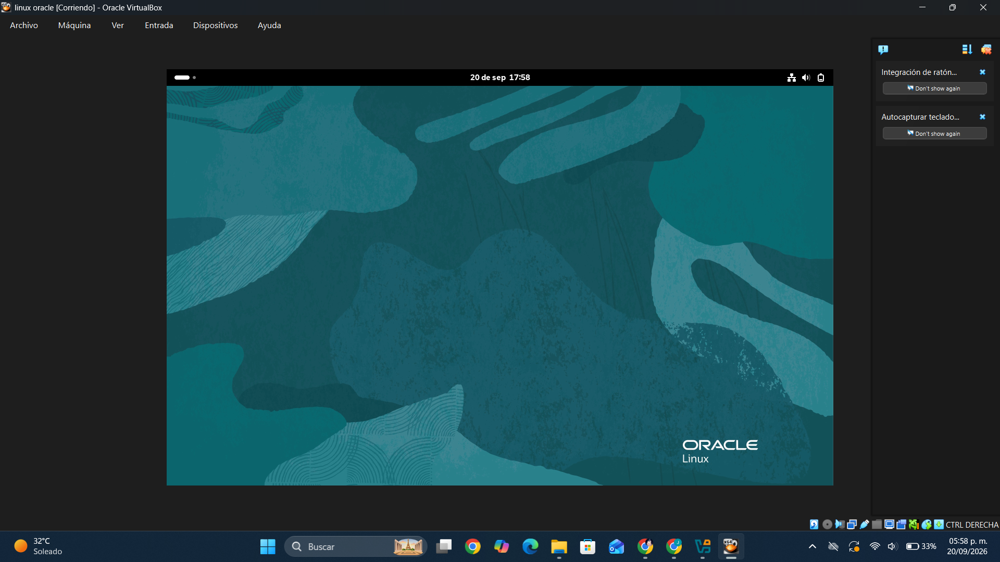
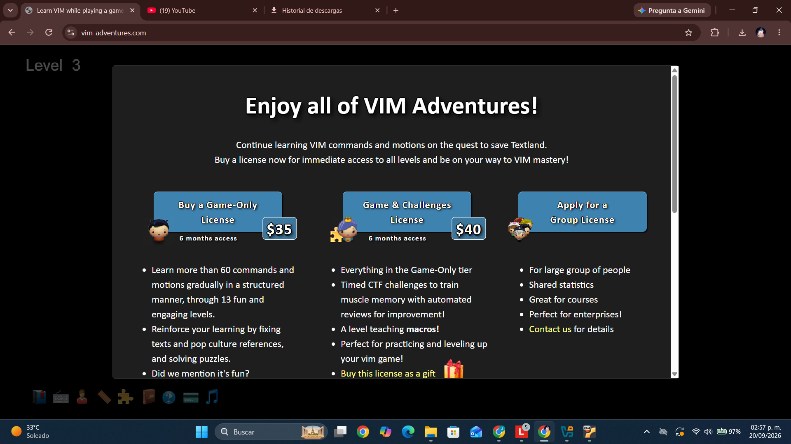
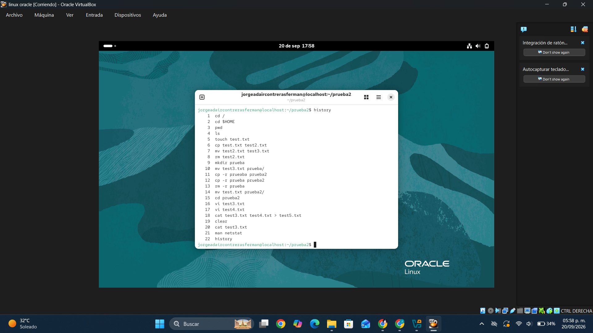

# tallersistemasoperativos

# Bitácora de clases — Taller de Sistemas Operativos

**Materia:** Taller de Sistemas Operativos  
**Profesor:** Ismael Jiménez   
**Alumno:** Jorge Adair Contreras Ferman
---

## Índice

1. [Primera clase]
2. [Segunda clase]
3. [Tercera clase]
4. [Cuarta clase]
5. [Quinta clase]
6. [Sexta clase]
7. [Séptima clase]
8. [Octava clase]
9. [Novena clase]
10. [Décima clase]
11. [Conclusión general]

---

# Primera clase

## ¿Qué vimos en clase?

El profesor se presentó, su nombre es Ismael Jiménez. Tiene un humor sarcástico. Nos explicó sobre las estadísticas de las tareas, el uso de Discord y que no debíamos hablar de cosas que no tuvieran relación con la materia. También nos explicó cómo utilizar GitHub.

## Conclusión

Fue una clase interesante y el profesor me pareció divertido.

## Temas principales

- Presentación del profesor.
- Organización de la materia.
- Uso de Discord.
- Uso de GitHub.
- Entrega y revisión de tareas.

## Lo que me llevo de la clase

Conocer la forma en que se trabajará durante el curso y las herramientas que utilizaremos para organizar nuestras actividades.

---

# Segunda clase

## ¿Qué vimos en clase?

Vimos la historia de los sistemas operativos, desde las primeras versiones de Windows y macOS hasta la evolución de Linux. También hablamos sobre sus versiones, servidores, usuarios y las distintas distribuciones de Linux.

## Conclusión

Fue una buena clase, aunque la tarea no me gustó mucho.

## Temas principales

- Historia de los sistemas operativos.
- Evolución de Windows y macOS.
- Historia y desarrollo de Linux.
- Servidores y usuarios.
- Distribuciones de Linux.

## Lo que me llevo de la clase

Comprender que los sistemas operativos han evolucionado con el tiempo y que existen distintas opciones según las necesidades de los usuarios.

---

# Tercera clase

## ¿Qué vimos en clase?

Vimos una tarea relacionada con la calificación. También aprendimos algunos comandos de Linux, como `cd`, `ls` y `touch`. Revisamos la estructura de directorios y la diferencia entre rutas relativas y absolutas.

## Conclusión

Obtuve una calificación de 8.9/10.

## Temas principales

- Comandos básicos de Linux.
- Navegación entre directorios.
- Creación de archivos.
- Rutas relativas.
- Rutas absolutas.

## Comandos vistos

| Comando | Función |
|---|---|
| `cd` | Cambiar de directorio. |
| `ls` | Mostrar el contenido de un directorio. |
| `touch` | Crear un archivo vacío o actualizar su fecha de modificación. |

## Lo que me llevo de la clase

Aprender a utilizar comandos básicos para moverme entre directorios y trabajar con archivos desde la terminal.

---

# Cuarta clase

## ¿Qué vimos en clase?

Vimos temas relacionados con GitHub. Tuve algunos problemas para iniciar sesión y también revisamos GitHub Education.

## Conclusión

La clase fue un poco aburrida, pero informativa.

## Temas principales

- Uso de GitHub.
- Acceso a la plataforma.
- GitHub Education.
- Herramientas para estudiantes.

## Lo que me llevo de la clase

Conocer mejor GitHub y las herramientas educativas que pueden ayudarme durante el curso.

---

# Quinta clase

## ¿Qué vimos en clase?

Vimos operadores lógicos y tablas de verdad, como `AND` y `OR`. También revisamos operadores relacionales, como `<`, `>`, `<=`, `>=` y `<>`.

## Conclusión

Al principio me pareció confuso, pero después logré entenderlo.

## Temas principales

- Operadores lógicos.
- Tablas de verdad.
- Operadores relacionales.
- Comparación de valores.

## Ejemplos

| Operador | Significado |
|---|---|
| `AND` | La condición es verdadera cuando ambas condiciones son verdaderas. |
| `OR` | La condición es verdadera cuando al menos una de las condiciones es verdadera. |
| `<` | Menor que. |
| `>` | Mayor que. |
| `<=` | Menor o igual que. |
| `>=` | Mayor o igual que. |
| `<>` | Diferente de, en algunos lenguajes y herramientas. |

## Lo que me llevo de la clase

Comprender que los operadores permiten comparar valores y evaluar condiciones, algo útil en programación y en el funcionamiento de los sistemas.

---

# Sexta clase

## ¿Qué vimos en clase?

Vimos algunos programas y temas de la materia, aunque no recuerdo mucho de lo que se explicó. El profesor también hizo algunas bromas durante la clase.

## Conclusión

La clase me pareció aburrida. Le daría un 5/10.

## Temas principales

- Revisión de programas y conceptos de la materia.
- Explicaciones del profesor.
- Participación durante la clase.

## Lo que me llevo de la clase

Esta clase me hizo darme cuenta de la importancia de tomar apuntes para recordar mejor los temas revisados.

---

# Séptima clase

## ¿Qué vimos en clase?

El profesor nos ayudó con GitHub y mostró ejemplos de los repositorios de algunos compañeros. También explicó qué cosas debemos hacer y qué cosas debemos evitar al organizar nuestros repositorios.

## Conclusión

Fue una clase informativa. Le daría un 10/10.

## Temas principales

- Organización de repositorios.
- Ejemplos de trabajos de compañeros.
- Buenas prácticas en GitHub.
- Errores que debemos evitar.

## Lo que me llevo de la clase

Aprender de los ejemplos de otros compañeros y mejorar la forma en que organizo y presento mis trabajos en GitHub.

---

# Octava clase

## ¿Qué vimos en clase?

Vimos una demostración de una inteligencia artificial llamada Halo. También hablamos sobre seguridad y videojuegos.

## Conclusión

El tema me pareció interesante, aunque la clase se sintió un poco aburrida en algunos momentos.

## Temas principales

- Inteligencia artificial.
- Demostración de Halo.
- Seguridad.
- Videojuegos y tecnología.

## Lo que me llevo de la clase

Conocer un ejemplo de cómo se puede utilizar la inteligencia artificial y relacionar estos avances con la seguridad y los videojuegos.

---

# Novena clase

## ¿Qué vimos en clase?

Vimos usuarios, grupos y permisos en Linux. Aprendimos sobre los comandos `chmod` y `chown`.

`chmod` sirve para modificar los permisos de lectura, escritura y ejecución de archivos y directorios. Por otro lado, `chown` sirve para cambiar el propietario y, cuando corresponde, el grupo de un archivo o directorio.

## Conclusión

Al principio me confundí con el tema, pero después lo repasé para comprenderlo mejor.

## Temas principales

- Usuarios de Linux.
- Grupos de usuarios.
- Permisos de archivos y directorios.
- Lectura, escritura y ejecución.
- Comandos `chmod` y `chown`.

## Comandos vistos

| Comando | Función |
|---|---|
| `chmod` | Modificar los permisos de archivos y directorios. |
| `chown` | Cambiar el propietario y, opcionalmente, el grupo. |

## Lo que me llevo de la clase

Comprender que los permisos permiten controlar quién puede leer, modificar o ejecutar archivos y que la administración de usuarios es importante para la seguridad del sistema.

---

# Décima clase

## ¿Qué vimos en clase?

Repasamos los temas para el examen. El profesor hizo un repaso general de los conceptos y explicó nuevamente algunos puntos importantes.

## Conclusión

Fue una buena clase e informativa. Sentí que estaba preparado para el examen.

## Temas principales

- Repaso de los temas anteriores.
- Revisión de conceptos importantes.
- Preparación para el examen.
- Resolución de dudas.

## Lo que me llevo de la clase

Reforzar los conocimientos que vimos durante las clases anteriores y reconocer los temas que debía repasar antes del examen.

---

# Conclusión general

Durante estas clases del Taller de Sistemas Operativos aprendí sobre la historia de los sistemas operativos, los comandos básicos de Linux, la organización de directorios, los permisos de archivos y el uso de GitHub. También vimos operadores lógicos y relacionales, inteligencia artificial y otros conceptos relacionados con la tecnología.

Algunos temas me resultaron más fáciles que otros. En ciertas clases me confundí al principio, pero pude comprender mejor algunos conceptos al repasarlos. También aprendí que es importante tomar apuntes, organizar mis trabajos y practicar los comandos para recordar cómo se utilizan.

En general, estas clases me ayudaron a conocer mejor los sistemas operativos y algunas de las herramientas que utilizaremos durante el curso.

---

# Fin de la bitácora

---
# Tarea 994

.png)

---
# Tarea 995

---
# Tarea 997

# Fin

---

# Bitácora de clases — Segundo Parcial

**Materia:** Taller de Sistemas Operativos  
**Profesor:** Ismael Jiménez  
**Parcial:** Segundo parcial   
**Alumno:** Jorge Adair Contreras Ferman

---

## Índice

1. [Primera clase]
2. [Segunda clase]
3. [Tercera clase]
4. [Cuarta clase]
5. [Quinta clase]
6. [Conclusión general]

---

# Primera clase

## ¿Qué vimos en clase?

En esta clase no hicimos la verdad nada más que hablar de unos temas a corregir de la clase.

## Temas principales

- Revisión de temas de la clase.
- Comentarios sobre aspectos que se debían corregir.

## Lo que me llevo de la clase

La importancia de revisar los temas anteriores y tener en cuenta los aspectos que necesitan corregirse para mejorar el trabajo durante el curso.

---

# Segunda clase

## ¿Qué vimos en clase?

El profe en esta clase nos enseñó cómo hacer llaves en GitHub y vincular Visual Studio Code para mandar tareas.

## Temas principales

- Uso de llaves en GitHub.
- Vinculación de Visual Studio Code con GitHub.
- Envío de tareas mediante las herramientas utilizadas.

## Lo que me llevo de la clase

Aprender a conectar las herramientas de trabajo para poder enviar tareas y trabajar con GitHub desde Visual Studio Code.

---

# Tercera clase

## ¿Qué vimos en clase?

El profe nos enseñó los niveles de Bandit y cómo hay que hacerle, y resolvió dudas.

## Temas principales

- Niveles de Bandit.
- Resolución de dudas.
- Procedimientos para avanzar en los niveles.

## Lo que me llevo de la clase

Conocer mejor los niveles de Bandit y comprender que es importante resolver las dudas para poder avanzar en las actividades.

---

# Cuarta clase

## ¿Qué vimos en clase?

El profe faltó a la clase.

## Temas principales

- No hubo clase debido a la ausencia del profesor.

## Lo que me llevo de la clase

No se registraron actividades ni temas nuevos en esta sesión.

---

# Quinta clase

## ¿Qué vimos en clase?

El profe andaba resolviendo dudas sobre los niveles de Bandit y verificando...

**Nota:** Falta completar la descripción de lo que el profesor estaba verificando.

## Temas principales

- Resolución de dudas sobre Bandit.
- Revisión de los niveles.

## Lo que me llevo de la clase

Repasar los niveles de Bandit y aclarar las dudas que surgen durante su realización.

---

# Tarea bandit

Bandit 0-1 
Usuario: bandit0 
Contraseña: bandit0 
comando: ls, cat readme 

Bandit 1-2 
Usuario: bandit1 
Contraseña: 6y2kwnwK6grgvwvpvLaa2T1cpFEKOhNR 
comando: ls, cat ./- 

Bandit 2-3 
Usuario: bandit2 
Contraseña: PK8fYLZg2hnHSz83plBL1iEPKdD3QToB 
comando: ls, cat "./--spaces in this filename--" 

Bandit 3-4 
Usuario: bandit3 
Contraseña: 7ZZ2LFrykP2zEyvBl4m3clcL7tGYJPME 
comando: cd inhere, ls -la, cat "./...Hiding-From-You" 

Bandit 4-5 
Usuario: bandit4 
Contraseña: xzTXq1rDJQVVAzdv5cHq1TQytTWufAMq 
comando: cd inhere, ls, file ./*, cat ./-file07 

Bandit 5-6 
Usuario: bandit5 
Contraseña: 6C7h9GD8M6ai5nr7wo1RonrzFjj9yIrG 
comando: cd inhere, ls, cat ./maybehere07/.file2 

Bandit 6-7 
Usuario: bandit6 
Contraseña: pXa26xhMWaC2SvDotA4r9EgZkulOeSBW 
comando: find / -type f -size 33c 2>/dev/null, cat /var/lib/dpkg/info/bandit7.password 

Bandit 7-8 
Usuario: bandit7 
Contraseña: Bmnnvf82KzQlfxgAI2d1zYbr1u9pr3E3 
comando: ls, grep "millionth" data.txt 

Bandit 8-9 
Usuario: bandit8 
Contraseña: VR1ljMayciFxbnUokuQmJFw6QC9VKtub 
comando: ls, sort data.txt | uniq -u 

Bandit 9-10 
Usuario: bandit9 
Contraseña: EjmOSvuAu7sGAHqHVcBDPirRe9T03kxl 
comando: ls, strings data.txt | grep "=" 

Bandit 10-11 
Usuario: bandit10 
Contraseña: B0s2khmbT9u0geKuOoVGW3JZKhndE3BG 
comando: ls, cat data.txt, base64 -d data.txt 

Bandit 11-12 
Usuario: bandit11 
Contraseña: pYfOY6HwUsDj5rL9UvyhU7MCmv8vN5Ro 
comando: ls, cat data.txt, tr 'A-Za-z' 'N-ZA-Mn-za-m' < data.txt 

Bandit 12-13 
Usuario: bandit12 
Contraseña: GROozWPO8QyN0mGrjUkID0WCYkZiQxrN 
comando: ls, cat data.txt, mkdir /tmp/bandit12, cd /tmp/bandit12, cp ~/data.txt ., xxd -r data.txt data.bin, file data.bin, cp data.bin data.gz, gunzip data.gz, tar, -tf, -xf, gunzip 

Bandit 13-14 
Usuario: bandit13 
Contraseña: qQYQiHOBPR8zR61qxYqX45quvihF2uzk 
comando: ls, file sshkey.private, chmod 600 sshkey.private, ssh -i sshkey.private bandit14@localhost -p 2220, exit 

Bandit 14-15 
Usuario: bandit14 
Contraseña: aaWecNkG4FhxJQxz07uiwzVP6bJiYS65 
comando: cat /etc/bandit_pass/bandit14 

Bandit 15-16 
Usuario: bandit15 
Contraseña: pbLYuZtTg4MgaqfJx8jbA9gKKGqM68A7 
comando: openssl s_client -connect localhost:30001 

Bandit 16-17 
Usuario: bandit16 
Contraseña: kS0Hf0u5HiXFwKMKFqXvPdOTNGGa0X8V 
comando: nmap localhost -p 31000-32000,  cat /etc/bandit_pass/bandit16 | openssl s_client -connect localhost:31790 -quiet 

Bandit 17-18 
Usuario: bandit17 
Contraseña: OQxXZjELndr90zuhOTDYBEomI0SZITXI 
comando: ls -la, diff passwords.old passwords.new 

Bandit 18-19 
Usuario: bandit18 
Contraseña: KpsOfPkcP7i1FlIExk2QEjyt6dw8dxZI 
comando:  

Bandit 19-20 
Usuario: bandit19 
Contraseña: 4pIjcunZ0fK2vmp3IwfG8Vf7VhxD6pOA 
comando: ls -la, ./bandit20-do --help, ./bandit20-do whoami 

Bandit 20-21 
Usuario: bandit20 
Contraseña: bW9kBv5WC3P4yoDyf12LSdGuNz5ka6hY 
comando: ls -la, ./suconnect --help 

Bandit 21-22 
Usuario: bandit21 
Contraseña: RYVux2rHEm9tiXHmLFzuR7Vhx6AZQMEz 
comando: ls -la, ls -la /etc/cron.d/, cat /etc/cron.d/cronjob_bandit22, cat /usr/bin/cronjob_bandit22.sh, cat /tmp/t7O6lds9S0RqQh9aMcz6ShpAoZKF7fgv,  

Bandit 22-23 
Usuario: bandit22 
Contraseña: gKXDTAXnIz3OBxiPjRZ2uqutUlPZrBsw 
comando: cat /etc/cron.d/cronjob_bandit23, cat /usr/bin/cronjob_bandit23.sh, echo I am user bandit23 | md5sum, cat /tmp/8ca319486bfbbc3663ea0fbe81326349 

Bandit 23-24 
Usuario: bandit23 
Contraseña: hVQMk3lJNsmQ7VF3ubyrNNBom7BOgVXv 
comando: cat /etc/cron.d/cronjob_bandit24, cat /usr/bin/cronjob_bandit24.sh, nano /tmp/getpass.sh, chmod +x /tmp/getpass.sh, cp /tmp/getpass.sh /var/spool/bandit24/foo/, cat /tmp/bandit24_password, cat /tmp/getpass.sh, ls -l /var/spool/bandit24/foo/, sleep 65, cat /tmp/bandit24_password 

Bandit 24-25 
Usuario: bandit24 
Contraseña: SoHfqMOEqIX2IYKVciZxvgpR9a2Djx4P 
comando: ls -la, ls -la /etc/cron.d/, nc localhost 30002, nano /tmp/brute.sh, chmod +x /tmp/brute.sh, /tmp/brute.sh | grep -v "Wrong!" 

Bandit 25-26 
Usuario: bandit25 
Contraseña: jHdv2ELQhT22BkprMNDjybZDAkw1zeBJ 
comando: ls -la, grep '^bandit26:' /etc/passwd, cat /usr/bin/showtext, client_loop: send disconnect: Connection reset,  

Bandit 26-27 
Usuario: bandit26 
Contraseña: STJLJBRRphMxKB392CT4iOr5CbzPU9ER 
comando: ls -la 

Bandit 27-28 
Usuario: bandit27 
Contraseña: y8Yd2ssKcpHpud7UvOSOxwamRMzIGIeQ 
comando: ls -la, cd 

Bandit 28-29 
Usuario: bandit28 
Contraseña: Em7eGtqaMySwNFjCpwzzHhLhospOcdt0 
comando: ls -la, cd .\repo, dir 

Bandit 29-30 
Usuario: bandit29 
Contraseña: jq9Dfg2rXsfYsWMgFuKlXhphjdH7USgX 
comando: ls -la, cd .\repo30, dir, type README.md 

Bandit 30-31 
Usuario: bandit30 
Contraseña: 82NkymblpGBYmIXG6ZQ8YldBYstHpfUf 
comando: ls -la, cd .\repo30, dir, type README.md, git tag, git show secret 

Bandit 31-32 
Usuario: bandit31 
Contraseña: pWuj5jBQ6IgV0NXwiH6g1pXRF8S1YvbT 
comando: cd .., ls -la, exit, git clone ssh://bandit31-git@bandit.labs.overthewire.org:2220/home/bandit31-git/repo repo31, cd .\repo31, dir, type .\README.md, Set-Content -Path .\key.txt -Value "May I come in?" -NoNewline, type .\key.txt, git add -f key.txt, git status, git commit -m "Add key.txt", git push origin master,  

Bandit 32-33 
Usuario: bandit32 
Contraseña: u4P2CyPOwPGLe94RdD9Uo2FxFwvnFswM 
comando: cd .., $0, $ whoami, $ cat /etc/bandit_pass/bandit33 

---

# Grabacion de menu (Tarea 993)

---

### Grabación de Asciinema

